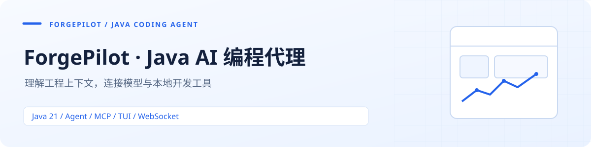
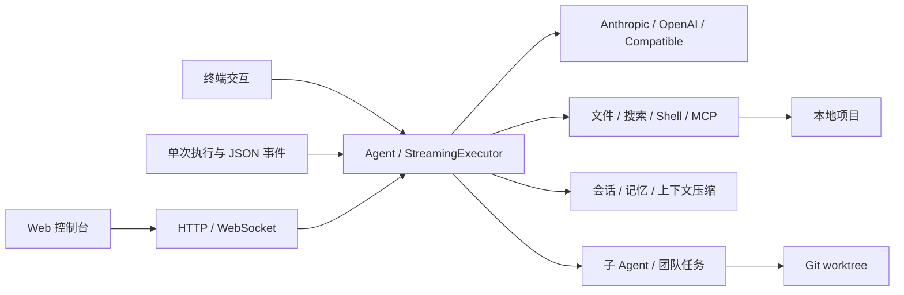

<div align="center">
  
  <h1>ForgePilot · Java AI 编程代理</h1>
  <p>理解项目上下文，调用本地工具，保留可恢复的开发会话。</p>


  <p><a href="#功能模块">功能模块</a> · <a href="#运行方式">运行方式</a> · <a href="#技术架构">技术架构</a> · <a href="#快速开始">快速开始</a> · <a href="docs/development-guide.md">开发文档</a></p>
</div>

## 项目介绍

**ForgePilot** 是基于 **Java 21** 的本地 AI 编程代理，面向希望理解 Agent 工具调用、上下文管理与任务协作机制的开发者。项目通过聊天模型读取工程上下文，调用文件读写、精确编辑、搜索与 Shell 等工具，辅助完成代码理解、修改和调试。

项目提供 **终端交互、非交互单次执行、Web 控制台** 三种运行方式，包含会话恢复、项目记忆、上下文压缩、MCP / Skill / Hook 扩展，以及子 Agent、团队任务板、消息邮箱与 Git worktree 支持。

> 项目定位：个人学习与工程实践展示。运行需要自行配置可用模型服务，仓库未提供免部署在线演示。工具会实际修改文件和执行命令；权限模式及各入口行为以当前实现为准。

## 运行方式

| 方式 | 入口 | 使用场景 |
| --- | --- | --- |
| **终端交互 · TUI** | `java -jar build/libs/mewcode.jar` | 持续对话、查看工具执行与权限交互 |
| **单次执行 · CLI** | `java -jar build/libs/mewcode.jar -p "请解释当前项目结构"` | 单次分析与脚本集成 |
| **结构化事件输出** | 单次执行时增加 `--output-format stream-json` | 接收流式 JSON 事件 |
| **Web 控制台** | 启动 `--remote` 后访问 `http://localhost:18888` | 浏览器会话、流式响应与工具交互 |

**推荐体验路线**：准备 JDK 与 Gradle → 配置模型 → 测试并打包 → 在测试项目中启动终端或 Web 控制台 → 了解目录与文件 → 提交小范围修改任务。

## 功能模块

| 模块 | 已有能力 | 对应源码 |
| --- | --- | --- |
| **Agent 与流式执行** | 模型对话、工具调用循环、事件流与执行状态 | [Agent](src/main/java/com/mewcode/agent) |
| **文件与命令工具** | 文件读写、精确编辑、Glob / Grep 搜索、Shell 与文件历史 | [工具实现](src/main/java/com/mewcode/tool/impl) |
| **模型适配** | Anthropic、OpenAI、OpenAI-compatible 三种协议 | [模型客户端](src/main/java/com/mewcode/llm) |
| **会话与上下文** | 会话保存恢复、项目记忆、上下文压缩与工具结果预算 | [会话](src/main/java/com/mewcode/session) / [压缩](src/main/java/com/mewcode/compact) / [记忆](src/main/java/com/mewcode/memory) |
| **MCP / Skill / Hook** | 外部工具、技能加载与执行、事件钩子 | [MCP](src/main/java/com/mewcode/mcp) / [Skill](src/main/java/com/mewcode/skill) / [Hook](src/main/java/com/mewcode/hook) |
| **多 Agent 与团队** | 子任务、共享任务板、消息邮箱与队友调度 | [子 Agent](src/main/java/com/mewcode/subagent) / [团队](src/main/java/com/mewcode/teams) |
| **工作目录隔离** | Git worktree 创建、会话关联与清理 | [Worktree](src/main/java/com/mewcode/worktree) |
| **交互入口** | TUI、单次执行、HTTP / WebSocket 控制台 | [终端](src/main/java/com/mewcode/tui) / [CLI](src/main/java/com/mewcode/print) / [Web](src/main/java/com/mewcode/remote) |

团队进程与沙箱能力依赖操作系统及 tmux / iTerm / bwrap 等外部工具，各平台支持范围需分别验证。

## 技术架构



| 层次 | 技术 |
| --- | --- |
| 语言与构建 | Java 21、Gradle 8.10.2、Shadow JAR |
| 终端 | JLine、Mordant、自有 TUI 事件循环 |
| 模型与扩展 | Anthropic Java SDK、OpenAI Java SDK、MCP Java SDK |
| Web 控制台 | Javalin、HTTP / WebSocket、内置 HTML 页面 |
| 配置与测试 | SnakeYAML、Jackson、JUnit Jupiter |

## 快速开始

### 1. 环境与源码

准备 **JDK 21**、**Gradle 8.10.2**、Git 和可用的 Bash，确认 `java` 与 `gradle` 可在终端调用。Windows 可使用 Git Bash；搜索等工具还需对应外部命令。

```powershell
git clone https://github.com/ifox-hu/forgepilot-java.git
cd forgepilot-java
New-Item -ItemType Directory -Force .mewcode
Copy-Item config.example.yaml .mewcode/config.yaml
```

Linux / macOS 对应使用 `mkdir -p .mewcode` 与 `cp config.example.yaml .mewcode/config.yaml`。

### 2. 配置模型

编辑 `.mewcode/config.yaml`，填写实际提供方的端点与模型名称：

```yaml
providers:
  - name: default
    protocol: openai-compat
    base_url: https://your-api-host/v1
    api_key:
    model: your-model-id

permission_mode: default
enable_coordinator_mode: false
```

`api_key` 留空时，`anthropic` 协议读取 `ANTHROPIC_API_KEY`，`openai` / `openai-compat` 读取 `OPENAI_API_KEY`。PowerShell 可设置：

```powershell
$env:OPENAI_API_KEY = '<your-api-key>'
```

配置模板不包含可用凭据。配置合并与指定配置文件方式见[开发文档](docs/development-guide.md)。

### 3. 测试、打包与启动

```powershell
gradle test shadowJar --console=plain

# 终端交互
java -jar build/libs/mewcode.jar

# 或启动 Web 控制台
java -jar build/libs/mewcode.jar --remote
```

产物为 `build/libs/mewcode.jar`。Web 模式启动后访问 `http://localhost:18888`，单次执行使用运行方式表中的 `-p` 命令。

### 4. Windows 后台启动（可选）

```powershell
.\start-project.ps1 -JavaHome '<JDK21目录>' -GradleHome '<Gradle8.10.2目录>' -Rebuild

# 停止由此脚本启动的服务
.\start-project.ps1 -JavaHome '<同一个JDK21目录>' -Stop
```

脚本默认工具路径为本机目录，换机器应显式传参。首次使用前先创建 `.mewcode/` 并完成配置；日志和 PID 保存在该目录中。

## 项目结构

```text
forgepilot-java/
├── src/main/java/com/mewcode/
│   ├── agent/                Agent 与流式执行
│   ├── llm/                  模型协议适配
│   ├── tool/                 文件、搜索与 Shell 工具
│   ├── compact/              上下文压缩与恢复
│   ├── session/ memory/      会话与项目记忆
│   ├── mcp/ skill/ hook/     外部工具与扩展
│   ├── subagent/ teams/      子 Agent 与团队协作
│   ├── worktree/             Git 工作目录管理
│   └── tui/ print/ remote/   终端、单次执行与 Web
├── src/main/resources/       内置 Web 控制台
├── src/test/java/            JUnit 测试
├── docs/                     首页素材与开发文档
├── config.example.yaml       不含凭据的配置模板
├── build.gradle.kts          依赖与构建配置
└── start-project.ps1         Windows 后台启动辅助脚本
```

## 项目文档

| 文档 | 内容 |
| --- | --- |
| [开发与运行说明](docs/development-guide.md) | 配置合并、启动命令、权限模式、日志与开发验证 |
| [模型配置模板](config.example.yaml) | Provider、默认权限和可选 MCP 配置 |
| [测试源码](src/test/java/com/mewcode) | 会话、工具、上下文、记忆与团队等模块的回归用例 |

## 来源与说明

源码保留“公众号 @小林coding”等来源注释。包名、配置目录与 JAR 名继续使用 `mewcode`，兼容当前实现。仓库尚未提供根目录许可证，不额外声明为 MIT、Apache-2.0 或其他许可；使用和再分发前应核对来源授权。

请勿提交真实 API Key、会话内容、本地配置或运行日志。问题与建议可提交到 [Issues](https://github.com/ifox-hu/forgepilot-java/issues)。

<div align="center"><a href="#项目介绍">返回顶部 ↑</a></div>
